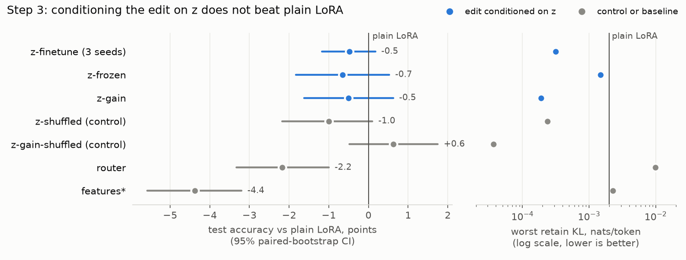

# Hypermodel

Can a model's own hidden states tell it how to edit itself?

A small **observer** network reads a frozen base model's residual stream while it answers. An **editor** turns
what the observer saw into a low-rank (LoRA) edit of the base model's weights. Later stages accumulate edits over a
stream of tasks, with a **generator** (hypernetwork) writing new experts and a fixed, sealed evaluator deciding
which edits stay.

Every stage has a pass bar written down before its data was seen ([`PREREGISTRATIONS.md`](PREREGISTRATIONS.md)),
capacity-matched controls, and paired-bootstrap confidence intervals. Two of the three hypothesis tests failed.
This README reports them as they came out.

**Testbed:** Qwen3-0.6B-Base, frozen, on synthetic arithmetic (few-shot, greedy decoding, exact match), one
8 GB RTX 5060. Base accuracy on 2-digit x 3-digit multiplication (mul-2x3): **33.5%**.

## Results at a glance

| Stage | Question | Pre-registered bar | Result | Verdict |
|---|---|---|---|---|
| 2. Observer | Does a 64-d code `z` read from hidden states predict whether the answer will be right? | AUROC >= 0.75 and, per seed, paired CI lower bound vs a question-features baseline >= -0.01 | AUROC **0.910** vs 0.900 (linear) / 0.906 (MLP) on question features | **pass** |
| 3. Transient editor | Does conditioning a per-question LoRA edit on `z` beat plain LoRA? | `z` editor beats plain LoRA and a question-features editor, paired 95% CI excluding 0, 3 seeds | **-0.47 pts [-1.18, +0.18]** vs plain LoRA; shuffled-`z` control ties real `z` | **fail (tie)** |
| 4. Generator pilot | Does a hypernetwork-generated LoRA expert beat a standard LoRA init given the same 50 refine steps? | A - B paired 95% CI lower bound > 0, 3 seeds | **+1.33 pts [-0.33, +3.07]** | **fail**; hypernetwork line stopped |
| 4. CL references | Where do floor and ceiling sit on the task stream? | measurement only, no bar | joint training **+2.8 [+1.9, +3.8]** over sequential LoRA; replay +0.3; oracle per-task bank -1.7 | measured |

The common thread: on this testbed, correctness under greedy decoding is close to a function of the question
itself, so a read of the model's internals has little to add over the question (step 2), an edit conditioned on
it does no better than one that ignores it (step 3), and a generator conditioned on recent failures behaves like a
task-level learned initialisation (step 4).

## Step 2: the observer

Residual-stream states at the operand and final tokens (layers 9, 14, 19) feed an MLP observer that outputs `z`
(64 dims) and a correctness head. On 4000 held-out questions (20k traces; splits keyed so `a*b` and `b*a` fall on
the same side), `z` reaches AUROC 0.910. Hand-made question features reach 0.900 (linear) and 0.906 (MLP).

The original bar was "beat question features by 0.05". Under greedy decoding that is unreachable however good the
observer is, so before the step 2 verdict the bar was reframed to non-inferiority and the real test, "do the
internals carry anything beyond the question?", was moved to step 3. The reframing is logged with its reason in
[`DECISIONS.md`](DECISIONS.md) and [`PREREGISTRATIONS.md`](PREREGISTRATIONS.md).

## Step 3: per-question edits conditioned on `z`

Every variant trains the same adapter: a bank of 8 rank-8 LoRA experts on the MLP output projection of layers
12, 15, 18 and 21 (about 1M parameters), base weights frozen. Loss is answer cross-entropy plus a **retain** KL
from the unedited model on unrelated text and other arithmetic, plus an edit-norm penalty. Variants differ only in
what picks the expert mix:

| Variant | Mixing chosen by | Controls for |
|---|---|---|
| `none` | a fixed learned mix (plain LoRA) | the standard baseline |
| `features` | the question's operands | "it only needs the question" |
| `z-frozen` / `z-finetune` | `z`, observer frozen / fine-tuned end to end | the hypothesis |
| `z-shuffled` | `z-finetune` fed another question's trace | `z`'s information vs extra trainable capacity |
| `z-gain` (+ shuffled) | `z` sets one strength per layer | whether `z` helps as a magnitude only |
| `router` | the hidden state at each token (mixture-of-LoRA style) | standard per-token routing |

4000 held-out questions, differences paired by question, 95% bootstrap CIs over questions:

| Variant | Test accuracy | vs plain LoRA (pts, 95% CI) | Worst retain KL | Trainable params |
|---|---|---|---|---|
| base model | 0.335 | | | |
| `none` (plain LoRA) | 0.468 / 0.475 / 0.465 | | 0.0020 | 1.05M |
| `z-finetune` | 0.457 / 0.471 / 0.465 | -0.47 [-1.18, +0.18] pooled | 0.0003 | 3.43M |
| `z-frozen` | 0.461 | -0.65 [-1.82, +0.53] | 0.0015 | 1.05M |
| `z-gain` | 0.463 | -0.50 [-1.62, +0.62] | 0.0002 | 3.43M |
| `z-shuffled` | 0.458 | -1.00 [-2.17, +0.10] | 0.0002 | 3.43M |
| `z-gain-shuffled` | 0.474 | +0.62 [-0.47, +1.75] | 0.00004 | 3.43M |
| `router`* | 0.446 | -2.17 [-3.33, -1.00] | 0.0099 | 1.15M |
| `features`* | 0.424 | -4.38 [-5.58, -3.20] | 0.0023 | 1.06M |

`none` and `z-finetune` ran 3 seeds, the rest seed 0. \* stopped at 3000 steps, the others at 5000.



- **`z`'s content is unused.** Real vs shuffled `z`: -0.05 [-1.20, +1.10].
- **The conditioning is not collapsed.** The mix varies per question (spread 0.6 to 1.6 against a pre-registered
  collapse threshold of 0.1; 6 to 8 effective experts of 8). It varies, but not with what the model gets wrong.
- **Lower side effects come from the architecture, not `z`.** The `z` editors drift about 10x less on unrelated
  inputs, and so do their shuffled controls.
- Two follow-ups (logit-lens conflict signals as observer input; sparse gating) were skipped by go/no-go rules
  fixed before their data.

## Step 4: a generator that writes experts

A hypernetwork (about 4.1M params) reads the frozen observer's summary of an episode's failures plus an encoding of
the current expert bank, and emits one rank-8 LoRA expert. The bank encoding is a rotation-invariant sketch of each
expert (`P_out^T U V^T P_in` with fixed random probes, normalised), pooled Deep-Sets style. The output head is
factorised and starts at zero, so an untrained generator emits a zero edit like a fresh LoRA. It was meta-trained
on four arithmetic settings disjoint from the stream by operand width (a test asserts disjointness at question
level).

**Pilot** (sealed 500-question mul-2x3 gate, 3 seeds, identical data order and refine for A and B):

| Seed | Base | A: generated + 50 steps | B: LoRA init + 50 steps | C: generated, no refine |
|---|---|---|---|---|
| 0 | .314 | .402 | .376 | .402 |
| 1 | .314 | .406 | .402 | .404 |
| 2 | .314 | .426 | .416 | .424 |

A - B pooled: +1.33 pts [-0.33, +3.07]. **Fail**, and per the pre-registered gate table the hypernetwork line
stops here. A = C on every seed: the refine steps add nothing to the generated expert.

Exploratory, run after the verdict and not pre-registered: replacing the episode's failing questions with random
rows changes nothing (-0.20 [-1.27, +0.87]), using another task's failures costs 3.1 pts, and with 200 refine steps
plain LoRA catches up completely (+0.07). The generator is a task-conditioned learned init, not an episode-specific
edit. This matches the meta-learning memorisation problem (Yin et al. 2020): when the query alone identifies the
task, a meta-learner can ignore its context.

## Continual-learning reference points

Stream: mul-2x3, mod-4x1, mul-3, mod-2, four 2000-question episodes each, equal step budgets for every method.
Final test accuracy per task, mean of 3 seeds; final average compared by a task-stratified paired bootstrap.

| Method | mul-2x3 | mod-4x1 | mul-3 | mod-2 | final avg | vs sequential LoRA, pts [95% CI] |
|---|---|---|---|---|---|---|
| base | .325 | .307 | .069 | .668 | | |
| sequential LoRA (penalised) | .384 | .625 | .078 | .657 | .436 | |
| sequential LoRA, no penalties | .284 | .620 | .051 | .629 | .396 | -4.0 [-5.0, -3.1] |
| replay (25% of each batch) | .360 | .652 | .081 | .664 | .439 | +0.3 [-0.6, +1.2] |
| oracle bank (one expert per task) | .389 | .632 | .075 | .583 | .420 | -1.7 [-2.7, -0.6] |
| joint (all tasks mixed) | .433 | .651 | .089 | .684 | .464 | +2.8 [+1.9, +3.8] |

The whole floor-to-ceiling span is under 3 points, which leaves a bank method little room on this stream.

**Interference, not forgetting.** Without penalties, training on mod-4x1 drives mul-2x3 from .38 to .00-.01,
*below* the frozen base model's .325. After the next task (mul-3), mul-2x3 returns to .37-.39 with no mul-2x3 data.
Nothing in the frozen base can be lost, so the collapse is the shared LoRA delta overriding the base for the other
operator family, and a same-family task undoes it. This is the "spurious forgetting" pattern reported for LLMs, and
it is why a per-task bank (oracle) gains nothing here: isolation removes interference that a related task would have
repaired anyway, and loses the positive transfer between them.

## How the results are kept honest

- **Pre-registration.** Bars, controls and go/no-go rules are fixed before any data; amendments are dated and made
  before the runs they affect ([`PREREGISTRATIONS.md`](PREREGISTRATIONS.md)). A failed test is never re-run with
  tweaks.
- **Capacity controls.** Shuffled-input twins separate "uses the information" from "has more parameters".
- **Paired statistics.** Every comparison is paired by question (or stratified by task) with bootstrap CIs
  (5000 resamples; 2000 for step 2's AUROC).
- **Sealed gates and leakage tests.** Gate sets never reach a trainer; tests assert question-level disjointness
  between observer traces, meta-training settings, stream splits and retain pools.
- **Determinism and drift checks.** Runs are deterministic per commit. Re-running the baseline at three commits
  found that an exact-in-maths loss refactor shifts bf16 training by 0.65 pts; comparisons within that margin are
  flagged as such.

## Limitations

- A toy task and a 0.6B model. Greedy decoding makes correctness nearly deterministic in the question, which is the
  setting least favourable to an observer. Noisier, regime-dependent outcomes are the natural next test.
- Bootstrap CIs resample questions, not seeds, so they understate seed-to-seed variance (plain LoRA spans 1 pt
  across 3 seeds). Several step 3 variants are single-seed, and `features` / `router` ran 3000 steps vs 5000.
- Exploratory step 4 results were not pre-registered and are reported as observations only.
- The continual-learning baselines were trained before the 0.65-pt loss refactor; replay (+0.3) and oracle (-1.7)
  are within about one such shift.

## How this was built

I designed the research questions, pre-registered every test, chose controls and made the go/no-go calls.
Most of the implementation was written by AI coding agents (Claude Code) working from my specs, behind test-first
development and review gates I set. Design decisions and their alternatives are logged in
[`DECISIONS.md`](DECISIONS.md).

## Running it

```bash
uv sync
uv run pytest -m "not slow"        # fast subset, ~25 s; full suite ~4 min on CPU
uv run python -m hypermodel.trace ...          # step 1: record traces
uv run python -m hypermodel.observer ...       # step 2
uv run python -m hypermodel.edit_train --traces runs/traces-mul-2x3-20k \
    --conditioning z-finetune --out runs/edit-z-finetune-s0          # step 3
uv run python -m hypermodel.stream --method naive --seed 0 ...       # step 4 stream
```

Traces and checkpoints (`runs/`) are not in the repo; the modules above regenerate them. One 8 GB GPU runs
everything. Set `CUDA_VISIBLE_DEVICES=` to test on CPU.

## Layout

`src/hypermodel/`: `arithmetic` (tasks and difficulty), `adapter` (model-agnostic hooks), `trace`, `observer`,
`probe` / `contrastive` / `sae` (step 2 inputs), `editor` (LoRA bank), `condition` (mixers), `retain` (retain set
and KL), `edit_train` (step 3), `stream` (task stream, sealed evaluator, CL methods), `generator` and `pilot`
(step 4), `compare` (paired and stratified bootstrap), `decide` (pre-registered queue rules), `watch`.
